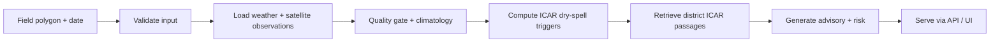

# FieldPulse

FieldPulse is a field-level monsoon dry-spell early-warning and advisory prototype for Telangana, India. The codebase implements the BreakWatch pipeline: it ingests weather and satellite inputs, validates field data, evaluates ICAR district contingency triggers, and serves a deterministic advisory through the API and web UI.

- The system is designed for monsoon stress detection during the kharif season.
- It combines rainfall, soil moisture, and remote-sensing signals with district contingency rules.
- It keeps the app safe when a source is missing: unavailable modules surface explicit unavailable/error states instead of fabricating numbers.

## What it includes

- A field input contract with polygon, as_of date, crop, sowing date, soil, and district context.
- Observation building for weather and remote-sensing data with time checks and quality gates.
- Dry-spell trigger evaluation against ICAR contingency thresholds.
- RAG-based retrieval of district-level ICAR contingency passages.
- A FastAPI run flow and browser UI for live or replay analysis.
- Replay support for past dates and a backtest-oriented workflow for trigger checks.

## How it works



## Data sources

| Source | Use |
|---|---|
| Open-Meteo ERA5-Land archive and forecast | Rainfall, ET0, temperature, soil moisture context |
| Planetary Computer STAC | Sentinel-2 / MODIS / district and cropland context |
| ICAR-CRIDA contingency plans | Trigger conditions and advisory citations |
| Telangana district boundaries | Field-to-district attribution |

## Modes

- Live: uses the current date, recent weather, and forecast data.
- Replay: evaluates a past date using data available up to that date without future leakage.

## Quickstart

```bash
python -m venv .venv
source .venv/bin/activate  # Windows: .\.venv\Scripts\Activate.ps1
pip install -r requirements.txt

# run the test suite
pytest -q

# run the API locally
uvicorn api.main:app --reload
```

Then open:

- http://localhost:8000/health
- http://localhost:8000/

## Repo layout

```text
FieldPulse/
├── agent/          # graph, tools, verifier, LLM scaffolding
├── api/            # FastAPI app, run flow, SSE endpoints, clock
├── common/         # baseline utilities, features, evidence ledger
├── data/           # test fields, weather archives, corpus, model metadata
├── geo/            # weather retrieval, quality gates, observation builders
├── ml/             # triggers, forecast, RAG, backtest workflow
├── scripts/        # helper scripts for dry-spell scans and data pulls
├── tests/          # project tests
├── web/            # browser UI shell
├── config.py       # shared thresholds and season metadata
├── contracts.py    # core schema definitions
├── requirements.txt
├── Makefile
├── README.md
└── STATUS_*.md     # milestone status notes
```

## Limitations

- The advice is scoped to Telangana and the district contingency corpus bundled with this repo.
- Some sensing modules are intentionally stubbed or unavailable in the current prototype.
- The project is a research/hackathon prototype, not a production risk-warning service.
- Model metadata is a reference artifact and may change as the training pipeline matures.

## Built for

Prototype field monitoring for Telangana dry-spell risk assessment and ICAR-grounded advisory generation.
